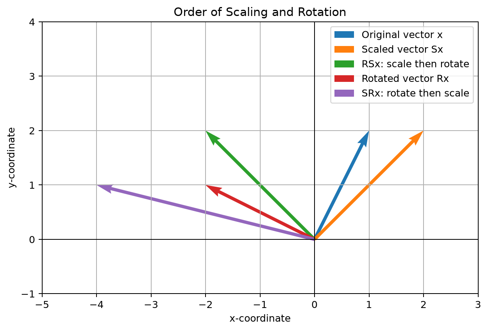

## Exercise 9. Composing Transformations
Let

$$
S=
\begin{pmatrix}
2 & 0 \\
0 & 1 \\
\end{pmatrix},\qquad R=
\begin{pmatrix}
0 & -1 \\
1 & 0 \\
\end{pmatrix}.
$$

By the end of this chapter, you should be able to:

- interpret a matrix product as a sequence of transformations;
- determine the order in which transformations are applied;
- calculate two different compositions of scaling and rotation; and
- explain why changing the order can change the result.

compute $RSx$ and $SRx$. Compare the results and explain geometrically why the order of these transformations matters.

A matrix represents a linear transformation of vectors. If $A$ and $B$ are
matrices and $x$ is a vector, then

## Solution

### 1. Order of Transformations in a Matrix Product

A matrix represents a linear transformation of vectors. When applying a sequence of transformations to a vector $x$, the order of application is evaluated from right to left:

$$
ABx = A(Bx)
$$

The rightmost matrix $B$ acts on $x$ first, and the matrix $A$ then acts on the resulting vector $Bx$.

In general, matrix multiplication is non-commutative ($AB \neq BA$). The following steps evaluate $RSx$ (scale, then rotate) and $SRx$ (rotate, then scale) for the given matrices and vector.

### 2. Computation of $RSx$ (Scale First, Then Rotate)

First, apply the scaling transformation $S$ to $x$:

$$
\begin{aligned}
Sx &=
\begin{pmatrix}
2 & 0 \\
0 & 1 \\
\end{pmatrix}
\begin{pmatrix}
1 \\
2 \\
\end{pmatrix} \\
&=
\begin{pmatrix}
2\cdot 1 + 0\cdot 2 \\
0\cdot 1 + 1\cdot 2 \\
\end{pmatrix} \\
&=
\begin{pmatrix}
2 \\
2 \\
\end{pmatrix}
\end{aligned}
$$

Next, apply the rotation transformation $R$ to the result $Sx$:

$$
\begin{aligned}
RSx &=
\begin{pmatrix}
0 & -1 \\
1 & 0 \\
\end{pmatrix}
\begin{pmatrix}
2 \\
2 \\
\end{pmatrix} \\
&=
\begin{pmatrix}
0\cdot 2 + (-1)\cdot 2 \\
1\cdot 2 + 0\cdot 2 \\
\end{pmatrix} \\
&=
\begin{pmatrix}
-2 \\
2 \\
\end{pmatrix}
\end{aligned}
$$

Alternatively, computing the composite transformation matrix $RS$:

$$
\begin{aligned}
RS &=
\begin{pmatrix}
0 & -1 \\
1 & 0 \\
\end{pmatrix}
\begin{pmatrix}
2 & 0 \\
0 & 1 \\
\end{pmatrix} \\
&=
\begin{pmatrix}
0 & -1 \\
2 & 0 \\
\end{pmatrix}
\end{aligned}
$$

Then multiplying by $x$:

$$
\begin{aligned}
RSx &=
\begin{pmatrix}
0 & -1 \\
2 & 0 \\
\end{pmatrix}
\begin{pmatrix}
1 \\
2 \\
\end{pmatrix} \\
&=
\begin{pmatrix}
-2 \\
2 \\
\end{pmatrix}
\end{aligned}
$$

### 3. Computation of $SRx$ (Rotate First, Then Scale)

First, apply the rotation transformation $R$ to $x$:

$$
\begin{aligned}
Rx &=
\begin{pmatrix}
0 & -1 \\
1 & 0 \\
\end{pmatrix}
\begin{pmatrix}
1 \\
2 \\
\end{pmatrix} \\
&=
\begin{pmatrix}
0\cdot 1 + (-1)\cdot 2 \\
1\cdot 1 + 0\cdot 2 \\
\end{pmatrix} \\
&=
\begin{pmatrix}
-2 \\
1 \\
\end{pmatrix}
\end{aligned}
$$

Next, apply the scaling transformation $S$ to the result $Rx$:

$$
\begin{aligned}
SRx &=
\begin{pmatrix}
2 & 0 \\
0 & 1 \\
\end{pmatrix}
\begin{pmatrix}
-2 \\
1 \\
\end{pmatrix} \\
&=
\begin{pmatrix}
2\cdot (-2) + 0\cdot 1 \\
0\cdot (-2) + 1\cdot 1 \\
\end{pmatrix} \\
&=
\begin{pmatrix}
-4 \\
1 \\
\end{pmatrix}
\end{aligned}
$$

Alternatively, computing the composite transformation matrix $SR$:

$$
\begin{aligned}
SR &=
\begin{pmatrix}
2 & 0 \\
0 & 1 \\
\end{pmatrix}
\begin{pmatrix}
0 & -1 \\
1 & 0 \\
\end{pmatrix} \\
&=
\begin{pmatrix}
0 & -2 \\
1 & 0 \\
\end{pmatrix}
\end{aligned}
$$

Then multiplying by $x$:

$$
\begin{aligned}
SRx &=
\begin{pmatrix}
0 & -2 \\
1 & 0 \\
\end{pmatrix}
\begin{pmatrix}
1 \\
2 \\
\end{pmatrix} \\
&=
\begin{pmatrix}
-4 \\
1 \\
\end{pmatrix}
\end{aligned}
$$

### 4. Comparison of the Results

Comparing the resulting vectors:

$$
RSx =
\begin{pmatrix}
-2 \\
2 \\
\end{pmatrix},
\qquad
SRx =
\begin{pmatrix}
-4 \\
1 \\
\end{pmatrix}
$$

Clearly:

$$
RSx \neq SRx
$$

Comparing the transformation matrices directly:

$$
RS =
\begin{pmatrix}
0 & -1 \\
2 & 0 \\
\end{pmatrix},
\qquad
SR =
\begin{pmatrix}
0 & -2 \\
1 & 0 \\
\end{pmatrix}
$$

Since $RS \neq SR$, the transformations do not commute. This inequality holds in general, not only for the specific vector $x$.

### 5. Geometric Explanation of Why the Order Matters

The difference in outcomes arises from how nonuniform scaling interacts with direction:

1. **Nonuniform scaling depends on the axes:**
   The matrix $S$ scales the horizontal ($x_1$) component by a factor of $2$, while leaving the vertical ($x_2$) component unchanged ($1\times$).

2. **Rotation swaps and reflects the axes:**
   A $90^\circ$ counterclockwise rotation sends the horizontal axis to the vertical axis and the vertical axis to the negative horizontal axis:
   $(x_1, x_2) \mapsto (-x_2, x_1)$.

3. **Comparing the two sequences:**
   - **Scale, then rotate ($RSx$):**
     The vector $(1, 2)$ has its horizontal coordinate doubled first, becoming $(2, 2)$.
     Rotating by $90^\circ$ then turns this into $(-2, 2)$. The stretched coordinate ends up in the vertical position.
   - **Rotate, then scale ($SRx$):**
     The vector $(1, 2)$ is rotated first, becoming $(-2, 1)$.
     Now the original vertical component ($2$) has rotated into the horizontal position (as $-2$). Applying the nonuniform scaling doubles this new horizontal coordinate to $-4$, while leaving the vertical coordinate $1$ unchanged, yielding $(-4, 1)$.

Because rotation interchanges which coordinates align with the axes of scaling, scaling *before* versus *after* rotation stretches different components of the original vector. Thus, the order of application changes the geometric result.

### 6. Visualization with Python

The following Python script computes the intermediate vectors and plots each stage of the transformations:

```python
import matplotlib.pyplot as plt
import numpy as np

S = np.array([[2, 0], [0, 1]])
R = np.array([[0, -1], [1, 0]])
x = np.array([1, 2])

scaled = S @ x
scale_then_rotate = R @ scaled
rotated = R @ x
rotate_then_scale = S @ rotated

vectors = [
    (x, "Original vector x", "tab:blue"),
    (scaled, "Scaled vector Sx", "tab:orange"),
    (scale_then_rotate, "RSx: scale then rotate", "tab:green"),
    (rotated, "Rotated vector Rx", "tab:red"),
    (rotate_then_scale, "SRx: rotate then scale", "tab:purple"),
]

fig, ax = plt.subplots(figsize=(8, 8))

for vector, label, color in vectors:
    ax.quiver(
        0,
        0,
        vector[0],
        vector[1],
        angles="xy",
        scale_units="xy",
        scale=1,
        label=label,
        color=color,
    )

ax.axhline(0, color="black", linewidth=0.8)
ax.axvline(0, color="black", linewidth=0.8)
ax.set_xlim(-5, 3)
ax.set_ylim(-1, 4)
ax.set_aspect("equal", adjustable="box")
ax.set_xlabel("x-coordinate")
ax.set_ylabel("y-coordinate")
ax.set_title("Order of Scaling and Rotation")
ax.grid(True)
ax.legend(loc="best")

output_path = (
    "solutions/1_Algebra/01_matrices_and_operations/"
    "problem_09_transformations.png"
)
plt.savefig(output_path, dpi=180, bbox_inches="tight")
plt.close()
```

### 7. Graphical Output


