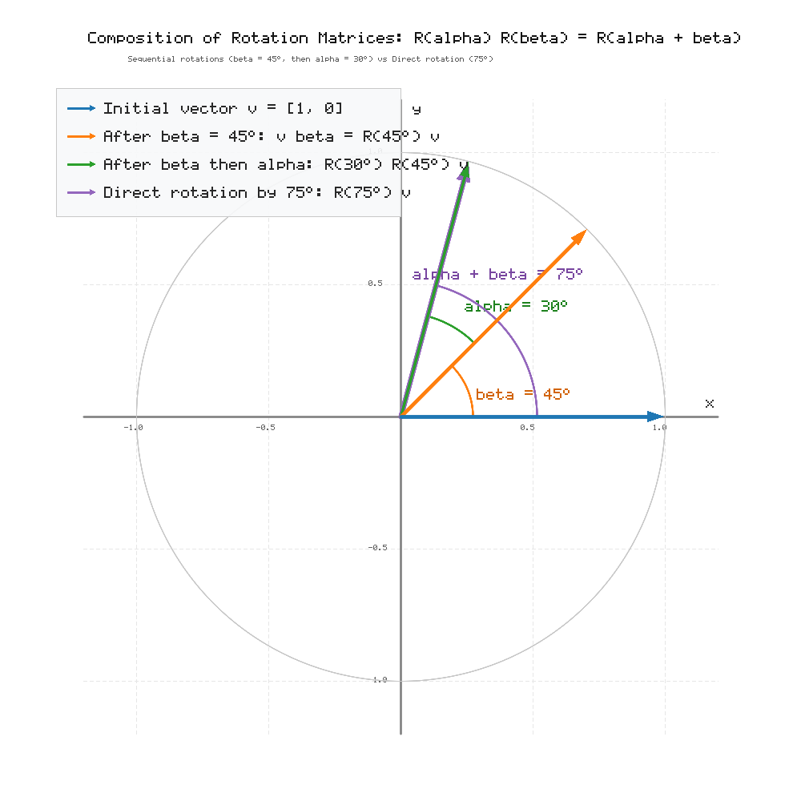

### Exercise 14. Rotation Matrices
The matrix for a rotation through an angle $\theta$ is

$$
R(\theta)=
\begin{pmatrix}
\cos\theta & -\sin\theta \\
\sin\theta & \cos\theta \\
\end{pmatrix}.
$$

Compute $R(\alpha)R(\beta)$ and, using the angle-sum formulas for sine and cosine, show that

$$
R(\alpha)R(\beta)=R(\alpha+\beta).
$$

Explain the result geometrically.

> **Why this exercise:** shows the consistency between matrix algebra and the geometry of composing rotations.

## Solution

### 1. Matrix Representation of the Two Rotations

Let $\alpha$ and $\beta$ be two rotation angles. The corresponding rotation matrices are

$$
R(\alpha)=
\begin{pmatrix}
\cos\alpha & -\sin\alpha \\
\sin\alpha & \cos\alpha \\
\end{pmatrix}
$$

and

$$
R(\beta)=
\begin{pmatrix}
\cos\beta & -\sin\beta \\
\sin\beta & \cos\beta \\
\end{pmatrix}.
$$

### 2. Matrix Multiplication $R(\alpha)R(\beta)$

Multiplying the two $2\times 2$ matrices using the standard row-by-column product:

$$
R(\alpha)R(\beta)=
\begin{pmatrix}
\cos\alpha & -\sin\alpha \\
\sin\alpha & \cos\alpha \\
\end{pmatrix}
\begin{pmatrix}
\cos\beta & -\sin\beta \\
\sin\beta & \cos\beta \\
\end{pmatrix}
$$

Evaluating each entry by taking the dot product of the corresponding row and column:

- **Top-left entry $(1,1)$:**
  Row 1 of $R(\alpha)$ times Column 1 of $R(\beta)$:

$$
\cos\alpha\cos\beta + (-\sin\alpha)\sin\beta = \cos\alpha\cos\beta - \sin\alpha\sin\beta
$$

- **Top-right entry $(1,2)$:**
  Row 1 of $R(\alpha)$ times Column 2 of $R(\beta)$:

$$
\cos\alpha(-\sin\beta) + (-\sin\alpha)\cos\beta = -(\cos\alpha\sin\beta + \sin\alpha\cos\beta)
$$

- **Bottom-left entry $(2,1)$:**
  Row 2 of $R(\alpha)$ times Column 1 of $R(\beta)$:

$$
\sin\alpha\cos\beta + \cos\alpha\sin\beta
$$

- **Bottom-right entry $(2,2)$:**
  Row 2 of $R(\alpha)$ times Column 2 of $R(\beta)$:

$$
\sin\alpha(-\sin\beta) + \cos\alpha\cos\beta = \cos\alpha\cos\beta - \sin\alpha\sin\beta
$$

Assembling the intermediate product:

$$
R(\alpha)R(\beta)=
\begin{pmatrix}
\cos\alpha\cos\beta - \sin\alpha\sin\beta & -\cos\alpha\sin\beta - \sin\alpha\cos\beta \\
\sin\alpha\cos\beta + \cos\alpha\sin\beta & \sin\alpha(-\sin\beta) + \cos\alpha\cos\beta \\
\end{pmatrix}
$$

Factoring out the minus sign in the top-right entry and reordering terms in the bottom-right entry gives

$$
R(\alpha)R(\beta)=
\begin{pmatrix}
\cos\alpha\cos\beta - \sin\alpha\sin\beta & -(\sin\alpha\cos\beta + \cos\alpha\sin\beta) \\
\sin\alpha\cos\beta + \cos\alpha\sin\beta & \cos\alpha\cos\beta - \sin\alpha\sin\beta \\
\end{pmatrix}
$$

### 3. Application of the Angle-Sum Formulas

Recall the standard trigonometric addition identities:

- **Cosine addition formula:**

$$
\cos(\alpha+\beta) = \cos\alpha\cos\beta - \sin\alpha\sin\beta
$$

- **Sine addition formula:**

$$
\sin(\alpha+\beta) = \sin\alpha\cos\beta + \cos\alpha\sin\beta
$$

Substituting these identities directly into the matrix yields

$$
R(\alpha)R(\beta)=
\begin{pmatrix}
\cos(\alpha+\beta) & -\sin(\alpha+\beta) \\
\sin(\alpha+\beta) & \cos(\alpha+\beta) \\
\end{pmatrix}
$$

By definition of the rotation matrix $R(\theta)$ with parameter $\theta = \alpha+\beta$,

$$
R(\alpha)R(\beta) = R(\alpha+\beta)
$$

### 4. Geometric Interpretation

The matrix $R(\theta)$ represents a counterclockwise rotation in $\mathbb{R}^2$ through an angle $\theta$ around the origin:

1. When applied to a vector $v$, the product $R(\alpha)R(\beta)v = R(\alpha)(R(\beta)v)$ means that $v$ is first rotated through an angle $\beta$ around the origin.
2. The resulting vector $R(\beta)v$ is then rotated through an angle $\alpha$ around the same origin.
3. Because both rotations are centered at the origin in the same orientation (counterclockwise in the plane), their composition is a single rotation whose angle is the sum of the individual angles: $\alpha+\beta$.

Therefore, matrix multiplication corresponds to function composition of linear geometric transformations, confirming that $R(\alpha)R(\beta) = R(\alpha+\beta)$.

### 5. Python Verification

The following script verifies the identity numerically and illustrates two successive rotations applied to a test vector:

```python
import numpy as np
import matplotlib.pyplot as plt

def rotation_matrix(theta):
    return np.array([
        [np.cos(theta), -np.sin(theta)],
        [np.sin(theta),  np.cos(theta)]
    ])

# Initial vector
v = np.array([1, 0])

# Rotation angles in degrees
alpha = 30
beta = 45

# Convert degrees to radians
alpha_rad = np.radians(alpha)
beta_rad = np.radians(beta)

# Apply rotations sequentially
v_beta = rotation_matrix(beta_rad) @ v
v_alpha_beta = rotation_matrix(alpha_rad) @ v_beta

# Apply composite rotation directly
v_direct = rotation_matrix(alpha_rad + beta_rad) @ v

# Verify numerical equality
print("Successive rotations:", v_alpha_beta)
print("Direct rotation:", v_direct)
print("Equal:", np.allclose(v_alpha_beta, v_direct))

# Plot the vectors
plt.figure(figsize=(7, 7))
plt.axhline(0, color="gray", linewidth=0.8)
plt.axvline(0, color="gray", linewidth=0.8)

plt.quiver(0, 0, v[0], v[1], angles="xy", scale_units="xy", scale=1, label="Initial vector v")
plt.quiver(0, 0, v_beta[0], v_beta[1], angles="xy", scale_units="xy", scale=1, label="After beta = 45 deg")
plt.quiver(0, 0, v_alpha_beta[0], v_alpha_beta[1], angles="xy", scale_units="xy", scale=1, label="After beta then alpha")
plt.quiver(0, 0, v_direct[0], v_direct[1], angles="xy", scale_units="xy", scale=1, label="Direct rotation by 75 deg")

plt.xlim(-1.2, 1.2)
plt.ylim(-1.2, 1.2)
plt.gca().set_aspect("equal")
plt.grid(True)
plt.xlabel("x")
plt.ylabel("y")
plt.title("Composition of Rotation Matrices")
plt.legend()

output_path = (
    "solutions/1_Algebra/01_matrices_and_operations/"
    "problem_14_rotations.png"
)
plt.savefig(output_path, dpi=180, bbox_inches="tight")
plt.close()
```

### 6. Graphical Output


