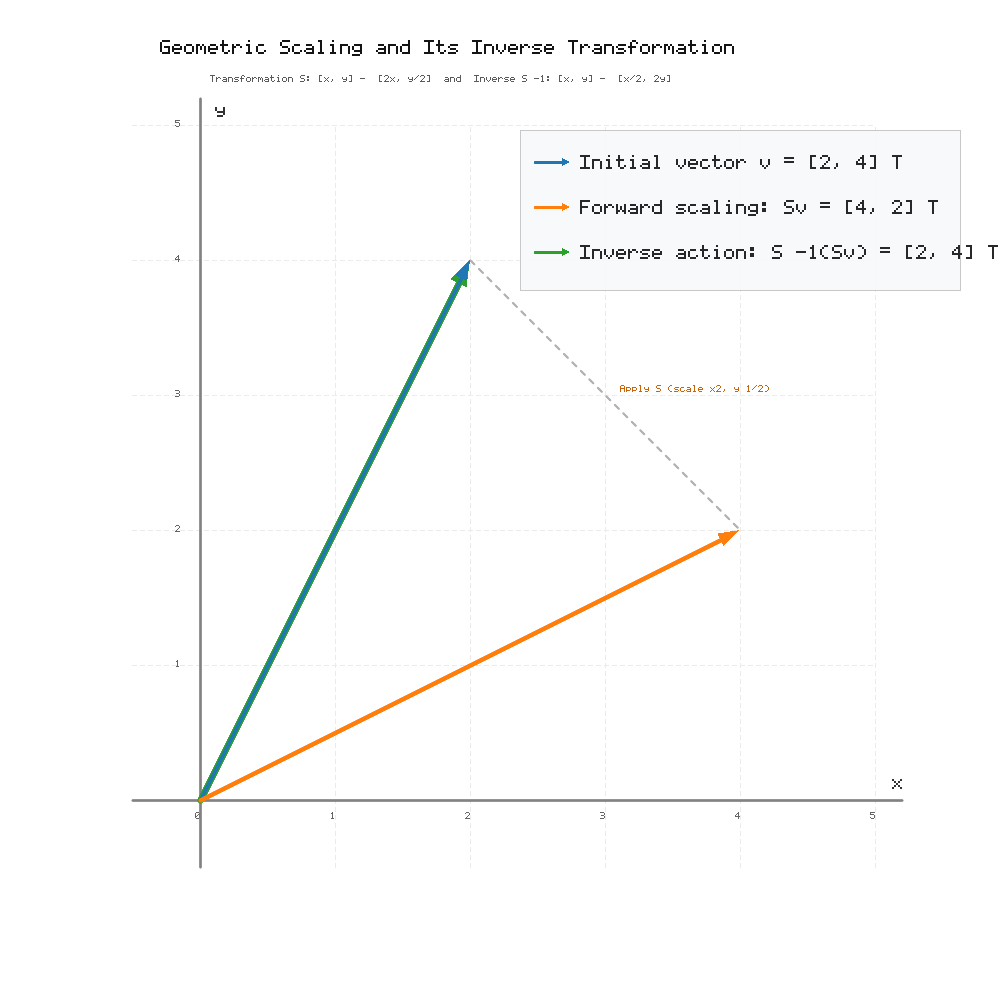

### Exercise 8. Inverse of a Transformation
The matrix

$$
S=
\begin{pmatrix}
2 & 0 \\
0 & \frac12 \\
\end{pmatrix}
$$

describes a scaling of the plane. Find $S^{-1}$ and explain geometrically what the inverse transformation does. Check the action of the pair $S,S^{-1}$ on one simple vector.

> **Why this exercise:** gives the inverse the interpretation of undoing a transformation.

## Solution

### 1. Computation of the Inverse Matrix $S^{-1}$

For the diagonal matrix

$$
S=
\begin{pmatrix}
2 & 0 \\
0 & \frac{1}{2} \\
\end{pmatrix}
$$

the determinant is

$$
\det S = 2\cdot \frac{1}{2} - 0\cdot 0 = 1
$$

Using the $2\times 2$ inverse formula:

$$
S^{-1} =
\begin{pmatrix}
\frac{1}{2} & 0 \\
0 & 2 \\
\end{pmatrix}
$$

For diagonal matrices, the inverse is obtained directly by taking the reciprocals of the diagonal entries: $2 \mapsto \frac{1}{2}$ and $\frac{1}{2} \mapsto 2$.

### 2. Geometric Interpretation

- **Transformation $S$:**
  Multiplication by $S$ stretches the horizontal coordinate ($x$) by a factor of $2$ and compresses the vertical coordinate ($y$) by a factor of $\frac{1}{2}$:

$$
\begin{pmatrix}
x \\
y \\
\end{pmatrix}
\mapsto
\begin{pmatrix}
2x \\
\frac{1}{2}y \\
\end{pmatrix}
$$

- **Inverse transformation $S^{-1}$:**
  Multiplication by $S^{-1}$ reverses this action: it compresses the horizontal coordinate by a factor of $\frac{1}{2}$ and stretches the vertical coordinate by a factor of $2$:

$$
\begin{pmatrix}
x' \\
y' \\
\end{pmatrix}
\mapsto
\begin{pmatrix}
\frac{1}{2}x' \\
2y' \\
\end{pmatrix}
$$

Geometrically, the inverse transformation exactly undoes the deformation caused by $S$, returning any scaled shape or vector back to its original position and proportions.

### 3. Verification on a Test Vector

Choose the test vector

$$
v=
\begin{pmatrix}
2 \\
4 \\
\end{pmatrix}
$$

Apply the forward transformation $S$:

$$
\begin{aligned}
Sv &=
\begin{pmatrix}
2 & 0 \\
0 & \frac{1}{2} \\
\end{pmatrix}
\begin{pmatrix}
2 \\
4 \\
\end{pmatrix} \\
&=
\begin{pmatrix}
2\cdot 2 \\
\frac{1}{2}\cdot 4 \\
\end{pmatrix} \\
&=
\begin{pmatrix}
4 \\
2 \\
\end{pmatrix}
\end{aligned}
$$

Now apply the inverse transformation $S^{-1}$ to the result $Sv$:

$$
\begin{aligned}
S^{-1}(Sv) &=
\begin{pmatrix}
\frac{1}{2} & 0 \\
0 & 2 \\
\end{pmatrix}
\begin{pmatrix}
4 \\
2 \\
\end{pmatrix} \\
&=
\begin{pmatrix}
\frac{1}{2}\cdot 4 \\
2\cdot 2 \\
\end{pmatrix} \\
&=
\begin{pmatrix}
2 \\
4 \\
\end{pmatrix} \\
&= v
\end{aligned}
$$

Applying $S$ followed by $S^{-1}$ restores the original vector $v$.

### 4. Graphical Output

