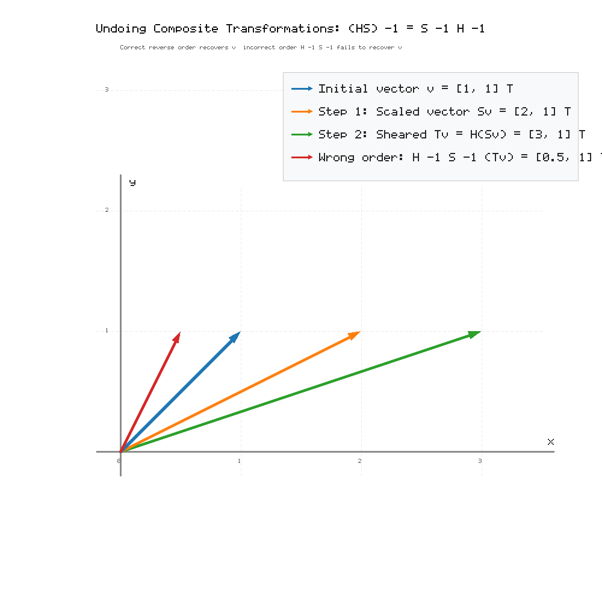

### Exercise 13. Undoing a Composite Transformation
The matrices

$$
S=
\begin{pmatrix}
2 & 0 \\
0 & 1 \\
\end{pmatrix},\qquad H=
\begin{pmatrix}
1 & 1 \\
0 & 1 \\
\end{pmatrix}
$$

describe nonuniform scaling and shear. For $T=HS$, find $T^{-1}$ in two ways:

1. first compute $T$, then its inverse,
2. use $(HS)^{-1}=S^{-1}H^{-1}$.

Compare the results. Additionally compute $H^{-1}S^{-1}$ and verify that the incorrect order gives a different matrix. Explain the rule: “when undoing a composition of operations, we undo them from the end.”

> **Why this exercise:** reinforces the inverse of a product in a less direct configuration.

## Solution

### 1. Method 1: Compute $T$ First, Then Its Inverse

Multiply $H$ and $S$ to find $T$:

$$
\begin{aligned}
T = HS &=
\begin{pmatrix}
1 & 1 \\
0 & 1 \\
\end{pmatrix}
\begin{pmatrix}
2 & 0 \\
0 & 1 \\
\end{pmatrix} \\
&=
\begin{pmatrix}
1\cdot 2 + 1\cdot 0 & 1\cdot 0 + 1\cdot 1 \\
0\cdot 2 + 1\cdot 0 & 0\cdot 0 + 1\cdot 1 \\
\end{pmatrix} \\
&=
\begin{pmatrix}
2 & 1 \\
0 & 1 \\
\end{pmatrix}
\end{aligned}
$$

The determinant of $T$ is

$$
\det T = 2\cdot 1 - 1\cdot 0 = 2
$$

Using the $2\times 2$ inverse formula:

$$
T^{-1} = \frac{1}{2}
\begin{pmatrix}
1 & -1 \\
0 & 2 \\
\end{pmatrix}
=
\begin{pmatrix}
\frac{1}{2} & -\frac{1}{2} \\
0 & 1 \\
\end{pmatrix}
$$

### 2. Method 2: Use $(HS)^{-1} = S^{-1}H^{-1}$

Find the individual inverses:

- For $S = \begin{pmatrix} 2 & 0 \\ 0 & 1 \\ \end{pmatrix}$, the determinant is $2$:

$$
S^{-1} =
\begin{pmatrix}
\frac{1}{2} & 0 \\
0 & 1 \\
\end{pmatrix}
$$

- For $H = \begin{pmatrix} 1 & 1 \\ 0 & 1 \\ \end{pmatrix}$, the determinant is $1$:

$$
H^{-1} =
\begin{pmatrix}
1 & -1 \\
0 & 1 \\
\end{pmatrix}
$$

Multiply in the reversed order $S^{-1}H^{-1}$:

$$
\begin{aligned}
S^{-1}H^{-1} &=
\begin{pmatrix}
\frac{1}{2} & 0 \\
0 & 1 \\
\end{pmatrix}
\begin{pmatrix}
1 & -1 \\
0 & 1 \\
\end{pmatrix} \\
&=
\begin{pmatrix}
\frac{1}{2}\cdot 1 + 0\cdot 0 & \frac{1}{2}\cdot (-1) + 0\cdot 1 \\
0\cdot 1 + 1\cdot 0 & 0\cdot (-1) + 1\cdot 1 \\
\end{pmatrix} \\
&=
\begin{pmatrix}
\frac{1}{2} & -\frac{1}{2} \\
0 & 1 \\
\end{pmatrix}
\end{aligned}
$$

Both methods yield the exact same inverse matrix:

$$
T^{-1} =
\begin{pmatrix}
\frac{1}{2} & -\frac{1}{2} \\
0 & 1 \\
\end{pmatrix}
$$

### 3. Computation of the Incorrect Order $H^{-1}S^{-1}$

Multiplying the inverses in the unreversed order:

$$
\begin{aligned}
H^{-1}S^{-1} &=
\begin{pmatrix}
1 & -1 \\
0 & 1 \\
\end{pmatrix}
\begin{pmatrix}
\frac{1}{2} & 0 \\
0 & 1 \\
\end{pmatrix} \\
&=
\begin{pmatrix}
1\cdot \frac{1}{2} + (-1)\cdot 0 & 1\cdot 0 + (-1)\cdot 1 \\
0\cdot \frac{1}{2} + 1\cdot 0 & 0\cdot 0 + 1\cdot 1 \\
\end{pmatrix} \\
&=
\begin{pmatrix}
\frac{1}{2} & -1 \\
0 & 1 \\
\end{pmatrix}
\end{aligned}
$$

Comparing the two products:

$$
S^{-1}H^{-1} =
\begin{pmatrix}
\frac{1}{2} & -\frac{1}{2} \\
0 & 1 \\
\end{pmatrix}
\neq
\begin{pmatrix}
\frac{1}{2} & -1 \\
0 & 1 \\
\end{pmatrix}
= H^{-1}S^{-1}
$$

This verifies that the incorrect order gives an entirely different matrix that fails to invert $T$.

### 4. Explanation of the Rule

The rule states: **“When undoing a composition of operations, we undo them from the end.”**

When $T = HS$ acts on a vector $x$:

$$
Tx = H(Sx)
$$

The scaling $S$ is applied first, and the shear $H$ is applied second to the already scaled vector.

To return to the original vector $x$:
1. The last applied operation was $H$. It must be undone first by applying $H^{-1}$:

$$
H^{-1}(H(Sx)) = Sx
$$

2. With the shear removed, the initial operation $S$ can now be undone by applying $S^{-1}$:

$$
S^{-1}(Sx) = x
$$

In algebraic terms:

$$
(S^{-1}H^{-1})(HS) = S^{-1}(H^{-1}H)S = S^{-1} I S = S^{-1}S = I
$$

If $S^{-1}$ were applied first, it would attempt to unscale a vector whose axes were already sheared by $H$, which fails to cancel the operations.

### 5. Graphical Output

