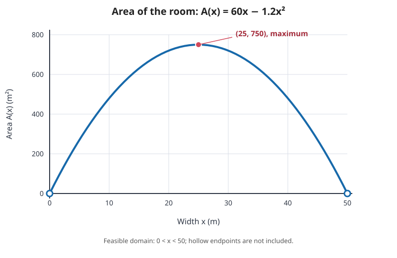

## Question

### Problem 12. Complete Model and Computer Verification

A museum wants to create a rectangular exhibition room next to an existing straight wall. The side along the wall does not need to be built. The remaining three sides are to be constructed to two different standards: the two sides perpendicular to the wall cost $300\ \mathrm{PLN/m}$ each, while the side parallel to the wall costs $500\ \mathrm{PLN/m}$. The budget is $30\,000\ \mathrm{PLN}$.

Build a model that maximizes the area of the room and prepare a complete analysis containing:

- definition of variables and units,
- mathematical model,
- domain resulting from the problem statement,
- computation of the derivative,
- determination and verification of the optimum,
- interpretation of the result,
- graph of the objective function,
- numerical verification of several values near the optimum found.

Finally, indicate which part of the solution required modeling the problem and which part was only the execution of the calculation. Produce the graph and computer calculations only after completing the mathematical solution, and treat them as verification.

## Solution

### 1. Define variables

Let:

- $x$ = length of each side perpendicular to the wall,
- $y$ = length of the side parallel to the wall.

All lengths are measured in meters.

The room is a rectangle with one side against the wall, so only three sides need to be built:

- two perpendicular sides, each of length $x$,
- one parallel side, of length $y$.

### 2. Build the budget equation

The cost is:

$$
2(300x)+500y=30000.
$$

So,

$$
600x+500y=30000.
$$

Solve for $y$:

$$
500y=30000-600x,
$$

$$
y=60-1.2x.
$$

### 3. Area function

The area is

$$
A=xy=x(60-1.2x)=60x-1.2x^2.
$$

This is the objective function.

### 4. Domain

Because the dimensions must be positive,

$$
x>0,\qquad y=60-1.2x>0.
$$

So,

$$
0<x<50.
$$

Therefore the domain is

$$
(0,50).
$$

### 5. Differentiate and find the optimum

$$
A'(x)=60-2.4x.
$$

Set equal to zero:

$$
60-2.4x=0
\quad\Rightarrow\quad
x=25.
$$

Then

$$
y=60-1.2(25)=60-30=30.
$$

So the maximum-area room has dimensions

$$
\boxed{x=25\text{ m},\qquad y=30\text{ m}}.
$$

### 6. Verify that it is a maximum

The second derivative is

$$
A''(x)=-2.4<0.
$$

Since the second derivative is negative for all $x$, the quadratic is concave down and the critical point gives a maximum.

The maximum area is

$$
A(25)=25\cdot30=750\text{ m}^2.
$$

So,

$$
\boxed{A_{\max}=750\text{ m}^2}.
$$

### 7. Interpretation of the result

The optimal room is $25$ m wide perpendicular to the wall and $30$ m long along the wall.

The two more expensive perpendicular sides cost more per meter, so the optimization naturally chooses a smaller width and larger length under the budget constraints.

### 8. Numerical checks near the optimum

- $x=24$:
  $$
y=60-1.2(24)=31.2,
  \quad A=24\cdot31.2=748.8.
  $$

- $x=25$:
  $$
y=30,
  \quad A=25\cdot30=750.
  $$

- $x=26$:
  $$
y=60-1.2(26)=28.8,
  \quad A=26\cdot28.8=748.8.
  $$

These values show that the area is smaller on both sides of $x=25$, confirming that $x=25$ gives the maximum area.

### 9. Graph of the objective function

The graph shows $A(x)=60x-1.2x^2$ for the geometric domain $0<x<50$. The hollow circles at $(0,0)$ and $(50,0)$ indicate excluded endpoints: at either endpoint, one of the room's side lengths would be zero. The vertex $(25,750)$ is the maximum.

### 10. What part was modeling and what part was calculation?

The modeling part was:

- choosing the variables,
- writing the cost constraint,
- translating the geometry into the area function,
- determining the domain from the real-world conditions.

The calculation part was:

- differentiating the function,
- solving the critical-point equation,
- checking the second derivative,
- evaluating the area at the optimum.

The graph and numerical verification are useful checks after the mathematical solution, but they do not replace the modeling and optimization reasoning.
